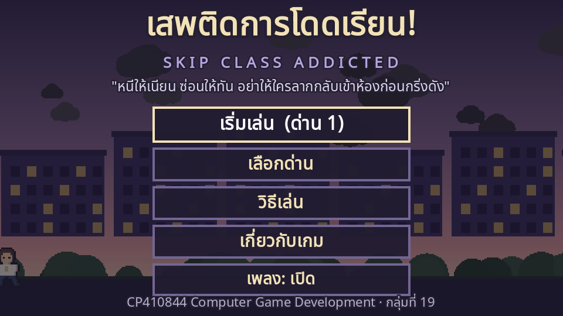
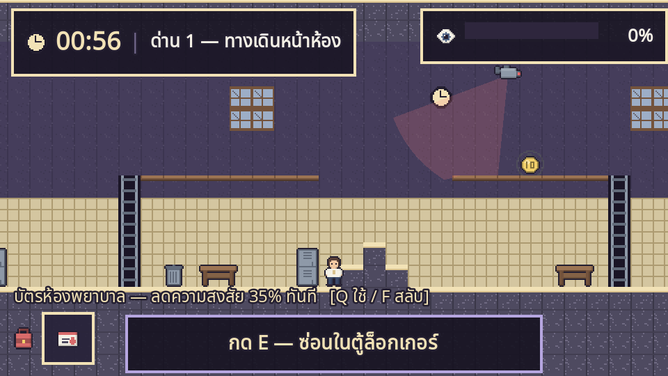
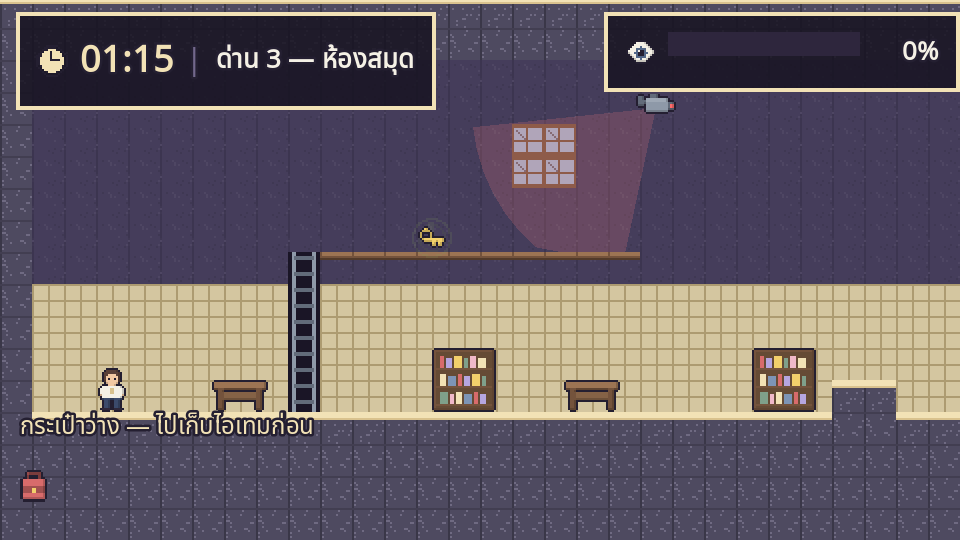
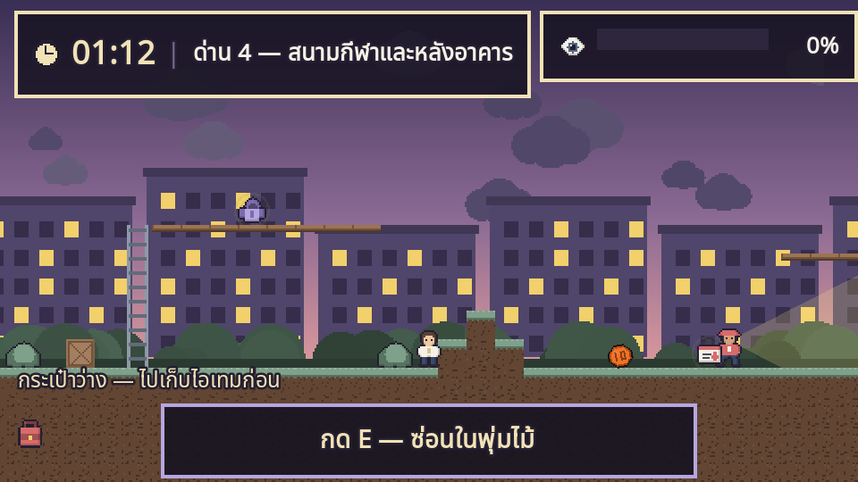
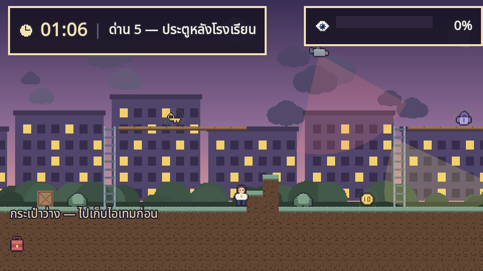
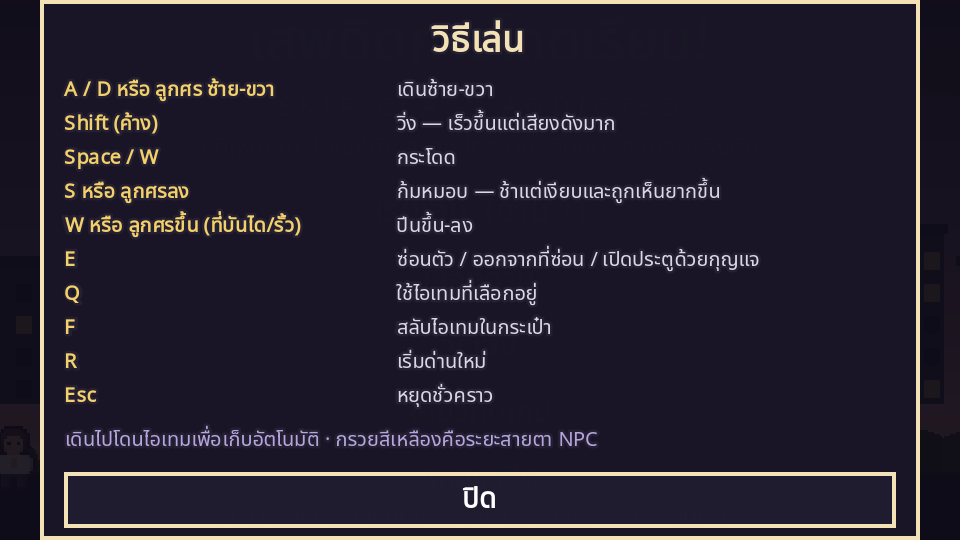
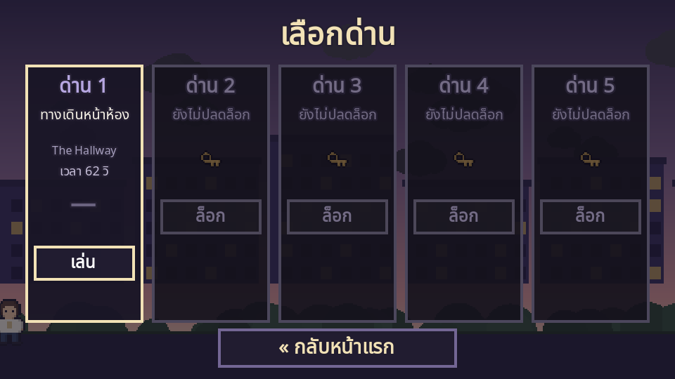

# เสพติดการโดดเรียน! — Skip Class Addicted

**2D Pixel Art Indie Stealth-Puzzle Platformer**

> "หนีให้เนียน ซ่อนให้ทัน อย่าให้ใครลากกลับเข้าห้องก่อนกริ่งดัง"

โปรเจกต์รายวิชา **CP410844 Computer Game Development** ภาคการศึกษาต้น ปีการศึกษา 2569 — **กลุ่มที่ 19**

### เล่นเกมออนไลน์

### ▶ https://napat-ice.github.io/Midterm_Project_GameDev/

เล่นได้เลยบนเบราว์เซอร์ ไม่ต้องติดตั้งอะไร (แนะนำ Chrome / Edge / Firefox บนคอมพิวเตอร์)



| | |
|---|---|
|  |  |
| **ด่าน 1 — ทางเดินหน้าห้อง** หลบครูในทางเดิน | **ด่าน 3 — ห้องสมุด** พื้นไม้ดัง ห้ามวิ่ง |
|  |  |
| **ด่าน 4 — สนามกีฬา** ปีนรั้ว หลบลูกบอล | **ด่าน 5 — ประตูหลังโรงเรียน** อยู่ให้รอดจนกริ่งดัง |

---

## เนื้อเรื่องย่อ

เช้าวันหนึ่งก่อนคาบแรก **"น็อต"** นักเรียนมัธยมที่เหนื่อยล้าจากการบ้านและสอบย่อย
ได้ยินข่าวว่าคาบแรกจะมีการสุ่มสอบแบบไม่บอกล่วงหน้า เขาจึงตัดสินใจทำภารกิจที่ใหญ่ที่สุด
ในชีวิตนักเรียน — **โดดเรียนให้สำเร็จ**

แต่มันไม่ง่าย เพราะครูประจำชั้น หัวหน้าห้อง รปภ. กล้องวงจรปิด และเพื่อนที่ชอบฟ้อง
ต่างพยายามพาน็อตกลับเข้าห้องเรียน ผู้เล่นต้องพาเขาหลบผ่านโซนต่าง ๆ ของโรงเรียน
ไปให้ถึง "จุดโดดเรียน" ก่อนกริ่งเข้าเรียนจะดัง

---

## วิธีเล่น

| ปุ่ม | การใช้งาน |
|---|---|
| `A` / `D` หรือ `←` `→` | เดินซ้าย–ขวา |
| `Shift` (ค้าง) | วิ่ง — เร็วขึ้นแต่**เสียงดังมาก** ดึงศัตรูเข้ามา |
| `Space` / `W` | กระโดด |
| `S` / `↓` | ก้มหมอบ — ช้าแต่เงียบ และถูกมองเห็นยากขึ้น 45% |
| `W` / `↑` (ที่บันไดหรือรั้ว) | ปีนขึ้น–ลง |
| `E` | ซ่อนตัว / ออกจากที่ซ่อน / ใช้กุญแจเปิดประตู |
| `Q` | ใช้ไอเทมที่เลือกอยู่ |
| `F` | สลับไอเทมในกระเป๋า |
| `R` | เริ่มด่านใหม่ |
| `Esc` | หยุดชั่วคราว |

เดินไปโดนไอเทมเพื่อเก็บอัตโนมัติ · **กรวยสีเหลือง** คือระยะสายตาของ NPC
กรวยจะเปลี่ยนเป็นสีส้มเมื่อเริ่มสงสัย และสีแดงเมื่อเห็นตัวแล้ว

ในเกมกดปุ่ม "วิธีเล่น" จากหน้าเมนูเพื่อดูตารางนี้ได้ตลอด



### เงื่อนไขชนะและแพ้

| สถานะ | เงื่อนไข |
|---|---|
| **ชนะ** | ไปถึงจุดโดดเรียนก่อนกริ่งดัง (ด่าน 5 ต้องอยู่ใน Safe Zone ตอนกริ่งดัง) |
| **แพ้ทันที** | เดินกลับเข้าห้องเรียนก่อนเวลา หรือถูกครู/รปภ. จับได้ |
| **แพ้จากระบบ** | ค่าความสงสัยเต็ม 100% หรือหมดเวลาก่อนหนีพ้น |

จบด่านแล้วจะได้ **เกรดความเนียน S / A / B / C** คิดจากเวลาที่เหลือ จำนวนครั้งที่ถูกเห็น
และค่าความสงสัยสูงสุดระหว่างด่าน เกรดที่ดีที่สุดของแต่ละด่านจะถูกบันทึกไว้ในหน้าเลือกด่าน



---

## ระบบหลักในเกม

- **Countdown System** — เวลานับถอยหลังจนกริ่งเข้าเรียน คือแรงกดดันหลักของทุกด่าน
- **Suspicion Meter** — ค่าความสงสัยเพิ่มเมื่อถูกเห็นหรือทำเสียงดัง เต็มเมื่อไหร่ถูกส่งกลับห้องทันที
- **Line of Sight** — NPC และกล้องมีกรวยสายตาจริงที่ถูกกำแพง ตู้ และชั้นหนังสือบัง
- **Noise System** — วิ่งเสียงดัง เดินเสียงเบา หมอบเงียบสนิท เสียงดึง NPC เข้ามาตรวจ
  และใช้เป็นเครื่องมือล่อได้
- **Excuse Dialogue** — เมื่อหัวหน้าห้องเข้ามาถาม ต้องเลือกข้ออ้างให้ถูกสถานการณ์
  ตอบถูกลดความสงสัย ตอบผิดพุ่งขึ้น 34%
- **Inventory Puzzle** — ไอเทม 6 ชิ้น แต่ละชิ้นแก้สถานการณ์ต่างกัน

### ไอเทม

| ไอเทม | ผลในเกม |
|---|---|
| บัตรห้องพยาบาล | ลดความสงสัย 35% ทันที และใช้ชนะบทสนทนาได้ |
| เหรียญ 10 บาท | โยนไปไกล ๆ เสียงตกดึง NPC ให้เดินไปดู |
| สมุดการบ้านปลอม | ชนะบทสนทนากับหัวหน้าห้องอัตโนมัติ |
| กุญแจห้องเก็บของ | ปลดล็อกประตูทางลัด |
| ป้ายพื้นเปียก | วางขวางทาง NPC จะไม่เดินผ่าน 12 วินาที |
| ฮู้ดกันหนาว | ปลอมตัว 9 วินาที ลดโอกาสถูกจำได้ 75% และกล้องมองไม่เห็น |

---

## ด่านในเกม

| ด่าน | สถานที่ | เป้าหมาย | อุปสรรคเด่น |
|---|---|---|---|
| 1 | ทางเดินหน้าห้อง | ออกจากโซนห้องเรียนโดยไม่ให้ครูเห็น | ครูประจำชั้น หัวหน้าห้อง กล่องขวางทาง |
| 2 | โรงอาหาร | ผ่านโรงอาหารที่คนแน่นไปทางออก | นักเรียนขี้ฟ้อง เสียงดังกว่าปกติ |
| 3 | ห้องสมุด | หากุญแจ เปิดประตูทางลัด | พื้นไม้ดังกว่าปกติ 2 เท่า บรรณารักษ์ กล้อง 2 ตัว |
| 4 | สนามกีฬาและหลังอาคาร | ข้ามสนาม ปีนรั้ว | ครูพละ 2 คน ลูกบอลที่กลิ้งมาชน |
| 5 | ประตูหลังโรงเรียน | เข้า Safe Zone แล้วรอดจนกริ่งดัง | รปภ. 2 คน กล้อง 3 ตัว ประตูล็อก |

---

## โครงสร้างโปรเจกต์

```
game/                     โปรเจกต์ Godot 4.7
  assets/sprites/         สไปรต์ทั้งหมด (สร้างด้วยสคริปต์)
  assets/fonts/           Noto Sans Thai (SIL OFL)
  scripts/                ระบบเกมทั้งหมด
    game_state.gd         ความคืบหน้า ไอเทม บทสนทนา (autoload)
    audio_manager.gd      สังเคราะห์เพลงและเสียงทั้งหมดตอนเปิดเกม (autoload)
    level_data.gd         ข้อมูลด่านทั้ง 5
    level.gd              สร้างด่านและคุมลูปเกม
    player.gd  npc.gd  cctv.gd  entities.gd
    ui/                   HUD เมนู บทสนทนา
  tools/                  สคริปต์สำหรับพัฒนา (ไม่รวมในตัวเกม)
    gen_assets.gd         วาดสไปรต์ทุกชิ้นจากกริดพิกเซล
    validate.gd           ตรวจว่าด่านไม่มีของฝังในกำแพง
    playtest.gd           ทดสอบเงื่อนไขชนะ/แพ้ทุกด่านอัตโนมัติ
    shot.gd               จับภาพหน้าจอทุกฉาก
docs/                     เว็บบิลด์ที่ GitHub Pages เสิร์ฟ
```

### สร้างเกมเอง

ต้องมี **Godot 4.7** พร้อม export template สำหรับ Web

```bash
# วาดสไปรต์ใหม่ทั้งหมด
Godot_v4.7-stable_win64.exe --headless --path game --script res://tools/gen_assets.gd

# ตรวจด่านและทดสอบเงื่อนไขชนะ/แพ้
Godot_v4.7-stable_win64.exe --headless --path game --script res://tools/validate.gd
Godot_v4.7-stable_win64.exe --headless --path game --script res://tools/playtest.gd

# export เป็นเว็บ
Godot_v4.7-stable_win64.exe --headless --path game --export-release "Web" "../docs/index.html"
```

เว็บบิลด์ตั้งค่า **thread support = off** เพื่อให้รันบน GitHub Pages ได้
โดยไม่ต้องตั้ง COOP/COEP header

---

## หมายเหตุด้านงานภาพและเสียง

สไปรต์ทุกชิ้นในเกมนี้วาดขึ้นเองด้วยสคริปต์ `tools/gen_assets.gd` จากกริดพิกเซล
ทำให้ตัวละคร ฉาก ไอเทม และไอคอนทั้งหมดใช้พาเลตต์เดียวกัน
(ม่วงพาสเทล ฟ้าอมเทา เหลืองนวล ชมพูอ่อน เขียวหม่น ตามที่ระบุในเอกสารออกแบบ)

เพลงและเอฟเฟกต์เสียงทั้งหมดสังเคราะห์ขึ้นตอนเปิดเกม (lo-fi chiptune)
ตัวเกมจึงไม่มีไฟล์เสียงเลย และเว็บบิลด์มีขนาดข้อมูลเกมเพียง ~300 KB

**ฟอนต์:** Noto Sans Thai — © The Noto Project Authors, ใช้ภายใต้ SIL Open Font License 1.1
(ดู `game/assets/fonts/OFL.txt`)

---

## ผู้จัดทำ — กลุ่มที่ 19

| ชื่อ | รหัสนักศึกษา |
|---|---|
| กษิเดช สุขศีล | 663380252-6 |
| ภูริณัฐ ศรีไตรรัตน์ | 663380531-2 |
| ณภัตร ช้อยกิ่ง | 663380262-3 |

---

*เกมนี้นำเสนอในเชิงตลกเสียดสีและฝึกการแก้ปัญหาภายใต้ข้อจำกัด
ไม่ได้มีเจตนาส่งเสริมให้หนีเรียนจริง*
